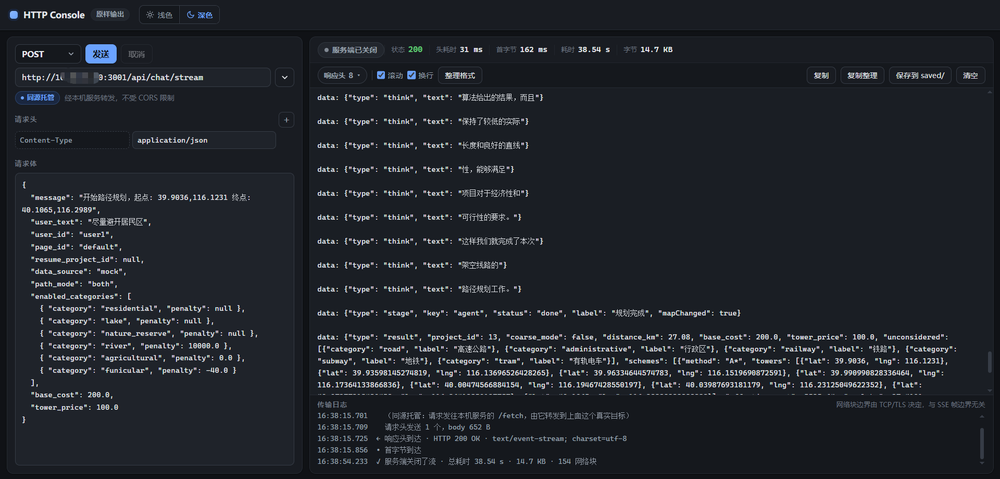

# HTTP Console

一个单文件的 HTTP / SSE 调试台。**它显示的就是服务端返回的原样字节**——不解析、不美化、不截断。



<details>
<summary><b>English</b></summary>

A single-file HTTP/SSE debugging console that shows you **exactly the bytes the
server sent** — no parsing, no pretty-printing, no truncation. It exists for one
question: *what does a colleague actually receive when they call this endpoint?*

Open `index.html` directly, or run `python server.py` and open the URL it prints.
The local service also forwards requests, so endpoints **without** CORS headers
work too — and in that mode response headers reach the page unmodified. Nothing
but the Python standard library is required.

Key properties: the response body is appended verbatim as raw bytes; a transport
readout distinguishes *"the server closed the stream"* from *"you cancelled"*;
export is byte-exact (original bytes, never re-encoded); filtering/formatting is
opt-in and clearly marked, and copy always returns the raw bytes.

The rest of this README is in Chinese, matching the UI.

</details>

## 它和 Thunder Client / Postman 有什么不一样

那些工具把响应当**对象**处理：解析 JSON、折叠结构、给字段上色。方便，但你会看不到"同事调这个接口时到底收到什么"。

这个工具把响应当**字节流**：

- **逐块追加原始字节**，一个字符都不动。`data: {...}\n\n` 长什么样就显示什么样
- **明确标出传输状态**：`连接中` / `接收中` / **`服务端已关闭`** / `已取消` / `出错`——你能分清"服务端关了流"和"本地按了取消"
- **导出是逐字节精确的**，留存的是服务端发来的原始字节，不经任何重新编码（连非法的 UTF-8 字节也原封不动）

## 快速开始

### 方式一：直接打开（简单，但受 CORS 限制）

双击 `index.html`。适合打**本来就配了 CORS** 的接口（自己的服务通常都配了）。

### 方式二：用自带的本机服务打开（推荐）

```bash
python server.py            # 默认 127.0.0.1:8099
python server.py 9000       # 换端口
```

然后浏览器打开它打印出来的地址。

**不需要安装任何依赖**，只用 Python 标准库。

## 两种模式的区别

工具会自己探测当前处于哪种模式，并在地址栏下方标出来。你不用选。

| | 直连（双击打开） | 同源托管（server.py） |
|---|---|---|
| 页面来自 | `file://` | `127.0.0.1:8099` |
| 请求发往 | 目标地址 | 本机服务的 `/fetch` |
| 浏览器看来 | **跨源** | **同源** |
| 能打没有 CORS 头的接口吗 | ❌ 不能 | ✅ 能 |
| 响应头 | 只有少数几个可见（CORS 白名单） | **不再按 CORS 裁剪，几乎全部可见** |
| 导出 | 浏览器下载 | **直接写进 `saved/` 文件夹** |

两点补充，免得你对"可见"有误解：

- **`Set-Cookie` 在哪种模式下都看不到**——它是浏览器规定**永远不对 JS 开放**的头，跟同源跨源无关。要确认它的完整内容只能用 `curl -i` 或抓包
- **`Content-Length` / `Transfer-Encoding` 在托管模式下来自本机服务**，不是目标的原值——流式回传必须重新分帧，这是物理要求

> **为什么需要本机服务？** 浏览器的同源策略禁止页面 JS 读取没有 `Access-Control-Allow-Origin` 头的跨源响应，而内网接口大多没配这个头。`server.py` 是普通 Python 进程，不受同源策略约束——它替浏览器去取，再把结果原样带回来。关键不是"有个服务在跑"，而是**页面把请求发给了自己的源**，所以 CORS 从头到尾不出现。

## 功能

**请求**

- 方法 / 地址 / 请求头 / 请求体，全部原样发送
- `Content-Type` 是固定行，不可删除（删了它浏览器会**静默**补上 `text/plain`，是个很容易排查半天的坑）。带候选值，也可自己填；留空 = 明确不发送这个头
- 浏览器**禁止 JS 设置**的请求头（`Connection`、`User-Agent`、`Cookie` 等）会标红并告警，不会静默丢弃

**响应**

- 原始字节逐块显示，带传输状态机、耗时 / 首字节 / 字节数
- 传输日志：目标地址、响应头到达、首字节、流结束（或本地取消）
- **复制**始终给原始字节；**导出**在同源模式下直接落盘到 `saved/`
- **整理格式**：按需把 SSE 帧 / JSON 缩进成可读的样子。默认关闭，且**原始字节全程不动**。开启时顶部有「非原始字节」警示条，复制按钮也会改名，避免你拿错

**常用请求**

- 地址栏右侧 `▾`：保存当前请求（整份：方法+地址+头+body）、点击载入、删除
- 支持导出 / 导入 JSON 文件，方便备份或转给同事

**其它**

- 浅色 / 深色主题
- 保存的请求用 localStorage；**同源模式下更可靠**（`file://` 下部分浏览器会限制）

## 已知限制

这些是浏览器的限制，不是工具的 bug：

- **Cookie 带不过去。** `Cookie` 属于浏览器禁止 JS 设置的头。需要 cookie 鉴权的接口，本工具帮不了
- **一批请求头设不了**：`Connection`、`Content-Length`、`Origin`、`Referer`、`User-Agent` 等（工具会标红提示）
- **整理后的内容不等于字节原样**：走的是 `JSON.parse` → `JSON.stringify`，会规范化数字与转义（`1.0` → `1`）。它只用于阅读，要比对字节请用原始视图或导出
- **超大响应**：超过 2 MB 会拒绝整理格式（缩进会把体积放大好几倍）；原始显示和导出不受影响
- **`Set-Cookie` 永远看不到**：浏览器规定它不对 JS 开放，跟同源跨源无关。要确认只能用 `curl -i` 或抓包
- **本机服务的安全边界**：`server.py` 只监听 `127.0.0.1`，且只接受本机来源的请求，否则任意网站都能借它读你的内网数据

## 文件

```
index.html         全部前端（单文件，无构建、无 CDN，离线可用）
server.py          可选的本机服务：既发页面，又转发请求（仅标准库）
saved/             同源模式下导出的响应落在这里（自动创建）
tests/             测试
LICENSE            MIT
```

## 测试

两份，分别对着前端行为和本机服务：

```bash
npm install                 # 只为了测试装 jsdom，运行时不需要任何依赖
npm test                    # 前端行为（jsdom 里跑，不需要浏览器）
npm run test:server         # 本机服务端到端（真起两个 HTTP 服务，只用标准库）
```

`tests/test_server.py` 可以脱离 npm 单独跑：`python tests/test_server.py`。

两份都在测**承诺**而不只是功能，重点覆盖：

- 响应体**逐字节**原样追加；导出字节精确（含非 UTF-8 字节）
- **流式**确实边到边推（会断言首末字节的到达跨度，攒成一坨就会失败）
- **同源模式下上游响应头一字不改**地透传
- 传输状态能区分「服务端关闭」与「本地取消」
- 陌生 Origin 读不到也写不进；`/save` 的路径穿越被夹在 `saved/` 内、且不覆盖同名文件
- 页面挂断连接不会让服务崩、也不会刷堆栈

## 许可

[MIT](LICENSE)
